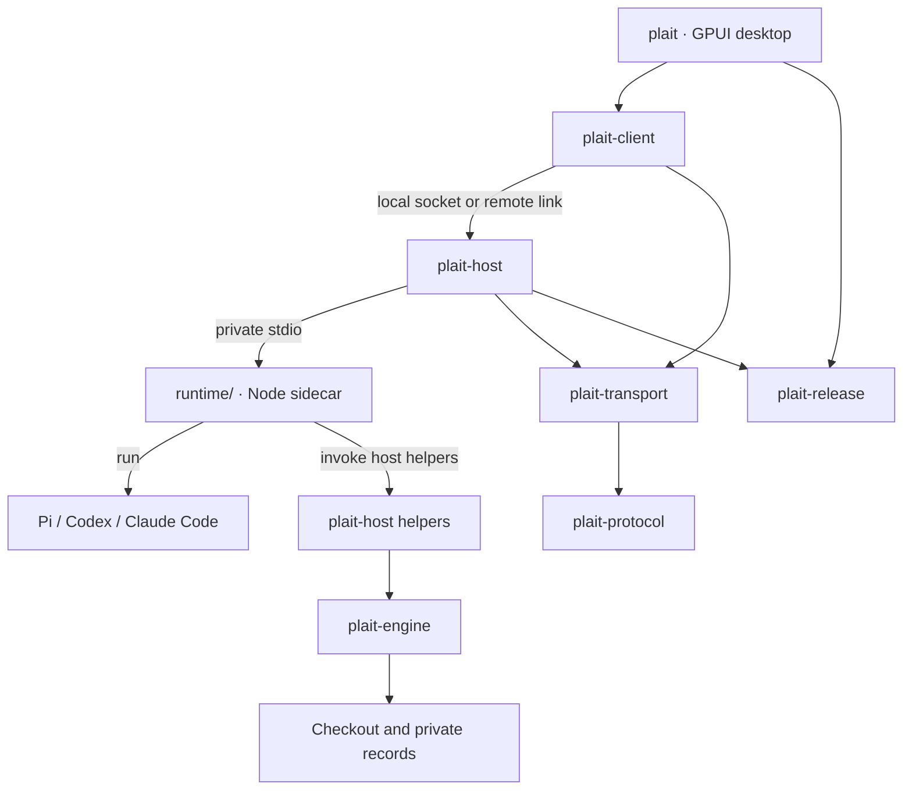
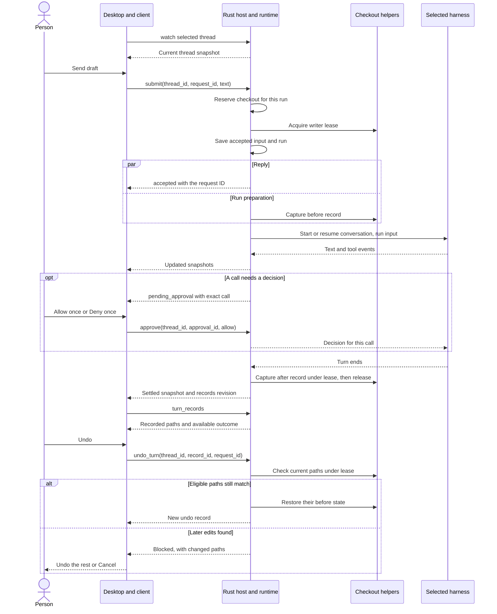

# How Plait works

A thread belongs to the machine that holds its checkout. The Mac app sends a
message to that machine's host. Once the host accepts it, you can close the
window. The next window can read what happened, answer a waiting approval,
or inspect the files the run changed.

## 1. The pieces and why they are separate

**Built.** There are two sides to a running Plait. The desktop takes input
and draws the workspace. The host owns the work. They can run on the same
Mac or on different machines. The arrows below show the path of a request
and the code used along the way.

- **The host and its runtime.** `plait-host run` starts the request server.
  Rust takes the store lock, binds the socket, starts Node, and checks the
  peer on each connection. The sidecar opens the store, recovers outstanding
  work, then serves requests. It owns the harness adapters, run scheduling
  and approvals. Its lifetime is tied to the host service, independently of
  the app. Follow `serve` and `connection` on the Rust side, then
  `Runtime.recover` and the TypeScript `serve`.
  [Host transport](../crates/plait-host/src/transport.rs) ·
  [Runtime entry](../runtime/src/main.ts) · [Sidecar I/O](../runtime/src/stdio.ts)
- **The engine.** A Git read, a checkout lease, and a turn record all need
  access to the actual machine. The Rust host's helpers call the engine for
  these operations. Git reads restrict the environment and disable optional
  locks, external diff, textconv, and filters. A lease coordinates writers
  across processes. The desktop can request a recorded diff without having
  the repository, or this crate, on the client side.
  [Git reads](../crates/plait-engine/src/git.rs) ·
  [Leases](../crates/plait-engine/src/lease.rs) · [Record helper](../crates/plait-host/src/record.rs)
- **The protocol.** Both sides need the same names and shapes for requests,
  snapshots, errors and events. The Rust crate defines these values and the
  encoding of remote frames. For example, `Frame::parse_header` can check a
  frame header using just its bytes. The runtime's validator and reply views
  implement the JSON contract in TypeScript.
  [Rust host types](../crates/plait-protocol/src/host/mod.rs) ·
  [Frame encoding](../crates/plait-protocol/src/frame.rs) · [Runtime protocol](../runtime/src/protocol.ts)
- **The transport.** Reading a frame from a stream and verifying a local
  socket require I/O. This crate supplies both sides with the same checks.
  The code that starts an SSH client or accepts a remote peer lives with
  the client or host that needs it.
  [Frame I/O](../crates/plait-transport/src/frame.rs) · [Local socket](../crates/plait-transport/src/local_socket.rs)
- **The client.** `plait-client` sends requests, reads watches, and holds the
  models used to present host state. It can check a reply against the
  selected checkout without a window. Its repository backend is
  `Backend::Host`, including for this Mac. It has no GPUI dependency.
  [Host client](../crates/plait-client/src/host.rs) · [Checkout backend](../crates/plait-client/src/state/backend.rs)
- **The desktop.** `plait` supplies the GPUI window, text input, focus and
  rendering. It dispatches host I/O on the background executor and applies
  the result to the relevant view. The code that draws the message box
  can change without changing what a host accepts.
  [Window](../crates/plait/src/ui/mod.rs) · [Host requests](../crates/plait/src/ui/host.rs) ·
  [Message box](../crates/plait/src/ui/thread_controls.rs)
- **Releases.** The desktop and host both need to find and verify downloads.
  `plait-release` shares that I/O and host installation code. For example,
  `download` checks a downloaded artifact against its signed size and
  SHA-256 before renaming the partial file. The manifest types and signature
  verification live in the protocol crate.
  [Downloads](../crates/plait-release/src/lib.rs) · [Installation](../crates/plait-release/src/install.rs) ·
  [Manifest verification](../crates/plait-protocol/src/update.rs)

**Planned.** A future iOS app could reuse the client layer. The current iOS
check compiles that library with its default features disabled.
[Crate boundaries](ARCHITECTURE.md#crate-boundaries) · [Dependency checks](../scripts/check.sh)

**Verification limits.** The dependency checks catch GPUI entering the
headless crates or the engine entering the desktop's normal dependencies.
A successful cross-build does not exercise a second client's connection,
input or rendering. [Verification](VERIFICATION.md)

## 2. One message, start to finish

**Built.** Follow a text message sent to an idle thread in a Git checkout.
The ordinary in-process run is shown here. A watch is a separate connection.
It can report a state change while the reply to Send is still in flight.

### From draft to accepted input

`message_box` places the draft, model and permission controls beside Send.
`Composer::submit` emits `ComposerEvent::Submit` with the text and draft
revision. Input-method composition blocks submission. On a new draft tab,
the first send also needs a host thread. Creating that thread binds it to a
checkout and harness. Creation alone makes no model call.
[Message box](../crates/plait/src/ui/thread_controls.rs) · [Composer](../crates/plait/src/ui/composer/mod.rs) ·
[Thread creation](../crates/plait/src/ui/new_thread.rs)

For a new thread, `create_with_admission` can probe `admission_info` and send
`create_admitted_thread`. When the project is busy, the host can return
`choice`. A new worktree starts from a captured commit and leaves uncommitted
files in the original checkout. An authorized project setting can select a
worktree automatically. An unanswered creation can be looked up with
`admission_status` using the same request ID.
[Desktop placement](../crates/plait/src/ui/admission.rs) · [Host admission](../runtime/src/admission.ts)

For the bound thread, `submit_message` keeps a pending submission with its own
request ID. The desktop flushes its recovery journal when required, uploads
any attached images, then sends `submit`. The text request names the thread,
the request ID and the text. Approval mode, busy behavior and checkout
identity depend on host support.
[Desktop send](../crates/plait/src/ui/host.rs) · [Request types](../crates/plait-protocol/src/host/mod.rs)

`connection` reads one bounded JSON line and calls `Sidecar::request`.
`Runtime.submit` checks for a duplicate. A retry with the same ID and text
gets the saved acceptance. Reusing it with different text is a conflict.
`Runtime.start` reserves the checkout before its asynchronous checks and
normally takes the writer lease here. If this host is finishing record
recovery, the run waits for the lease before capture. Another writer can
cause a busy refusal. No two Plait runs write the same checkout together.
[Request server](../crates/plait-host/src/transport.rs) · [Runtime admission](../runtime/src/runtime.ts) ·
[Checkout lease](../runtime/src/safety.ts)

The host commits the input and run row before acknowledging a direct send.
The reply carries `accepted: true`. It means the host took responsibility
for the input. If the connection drops before the reply arrives, the client
can retry the same ID. The watch supplies the visible request and running state.
An acknowledgement clears only the draft text and revision it belongs to.
If you typed something else while waiting, the newer draft stays in the box.
[Durable admission](../runtime/src/store.ts) · [Draft::clear_revision](../crates/plait/src/ui/composer/draft.rs)

There are two ways for an accepted message to wait. In an active thread,
`submit` with `when_busy: follow_up` starts another run later. With
`when_busy: steer` a supporting harness can take it during this run.
The box shows queued input separately until it enters the conversation.
To wait for a checkout held by another thread, choose **Wait**. That sends
`submit_checkout` on a capable host. The sidebar can show its place in line.
A busy refusal alone puts nothing in either queue.
[Thread controls](../crates/plait/src/ui/thread_controls.rs) · [Checkout queue controls](../crates/plait/src/ui/checkout_queue.rs) ·
[Queue contract](HOST.md#durable-checkout-queue)

### Before the first effect

`Runtime.run` verifies the checkout, holds the lease and starts cleanup
tracking. For a Git thread, `Records.before` must succeed before any harness
starts. The record helper calls the engine's `record` with private Git
bookkeeping. The person's HEAD and index stay in place. The app can show
“Preparing checkout…” or “Waiting for preparation…” during this interval.
A failed before record ends the run with an error.
[Run](../runtime/src/runtime.ts) · [Records](../runtime/src/records.ts) ·
[Capture](../crates/plait-engine/src/git/record.rs) · [Preparation display](../crates/plait/src/ui/admission.rs)

The record covers working-tree bytes, executable bits and symlink targets,
subject to limits. For example, an ignored directory is excluded and a
single file over 100 MiB is excluded. The host keeps coverage reasons.
An editor outside Plait can still change a file while the host reads it.
A thread created in a plain folder can run, but has no Git turn records or Undo.
[Record coverage](HOST.md#contents-and-limits) · [Plain folders](HOST.md#plain-folders)

### The run and its approvals

The thread's harness selects one of three paths through `Runtime.run`.
They share admission, checkout recording, and the thread view. They differ
in how the model receives the input and who enforces tool permissions.
[Harness dispatch](../runtime/src/external/registry.ts) · [Run and adapters](../runtime/src/runtime.ts)

- **Pi.** `TurnExecutor.open` opens the thread's conversation.
  `TurnExecutor.run` submits the input using the selected model, thinking
  level and turn limit. Plait supplies Pi's tools. The run's Ask or Auto
  choice governs ordinary edit and command approvals. The project command
  policy separately chooses sandboxed or trusted execution. Linux refuses
  sandboxed commands. [Turn executor](../runtime/src/turn-executor.ts) ·
  [Tools](../runtime/src/tools.ts) · [Command policy](../runtime/src/command/policy.ts)
- **Codex.** `runCodex` acquires a Codex app-server connection.
  `CodexRun` sends `thread/start` or `thread/resume`, then `turn/start`.
  It translates events and approval requests into the thread view. Codex
  applies its own sandbox and permission mode.
  [Codex run](../runtime/src/codex/run.ts) · [Codex approvals](../runtime/src/codex/approval.ts)
- **Claude Code.** `runClaude` starts a turn through the Claude Agent SDK.
  The adapter supplies the thread's mode and the `canUseTool` callback,
  and can resume a saved session. It translates SDK messages into entries
  for Plait history. Each external harness uses its own credentials.
  [Claude run](../runtime/src/claude/run.ts) · [Claude approvals](../runtime/src/claude/approval.ts) ·
  [External entries](../runtime/src/external/entries.ts)

The selected thread's `watch` first returns a snapshot. Changes wake the
server through a private notification channel. It reads the new snapshot
and sends it when it differs. As text or tool events arrive, the app shows
the reply as it grows and the work beneath the request. The state line can
change from “Waiting for the model…” to “Writing…” or “Running tools…”.
For older messages outside the bounded preview, it can request pages with
`history` and text with `history_text`.
[Watch delivery](../crates/plait-host/src/transport.rs) · [Client subscription](../crates/plait-client/src/host/watch.rs) ·
[State line](../crates/plait-client/src/history.rs) · [Conversation](../crates/plait/src/ui/live_conversation.rs)

When a call needs permission, the snapshot changes to `awaiting_approval`
and includes `pending_approval`. The card takes the message box's place.
It shows the proposed call, its details and any reported risk or dirty
paths. **Reply instead** reveals the saved composer. **Allow once** and
**Deny once** send `approve` with that approval ID and decision. A stale
answer cannot approve a different call. The external adapters explain
their own protections. Pi's dirty-file guard does not extend to them.
[Approval card](../crates/plait/src/ui/live_conversation.rs) · [Runtime decisions](../runtime/src/runtime.ts) ·
[Run authorization](../runtime/src/authorization.ts)

**Stop** sends `stop`. It revokes the run's authorization and signals
cancellation. The host holds the checkout until it can account for cleanup.
If cleanup is uncertain, a durable hold blocks new writes. Closing the
window merely drops its watches. An approval can still be answered from
another connection to the running host.
[Cleanup](../runtime/src/cleanup.ts) · [Stop and cleanup handling](../runtime/src/runtime.ts)

### The closing line and Undo

Once the harness closes and cleanup is confirmed, `finishCleanup` calls
`Records.after` while the run still holds the lease. Comparison with the
before record produces the net changed paths. A steered input shares the
pair. A follow-up that starts its own run gets its own pair. Capture is
attempted after failure or Stop too. A failed after record leaves Undo
unavailable. The host releases the lease before it publishes idle.
[Run completion](../runtime/src/runtime.ts) · [Before and after records](../runtime/src/records.ts)

The desktop reads `turn_records` when the records revision changes.
`record_line` draws the outcome, the step count when known, and the file
count with available line totals. A ready record with no paths says
“no files changed”. A failed or stopped turn keeps its work visible.
Finished work can fold. The line can also flag a moved HEAD or capture
after restart. A missing historical outcome can read “Outcome unavailable”.
[Closing line](../crates/plait/src/ui/turn_records.rs) · [Fold decisions](../crates/plait-client/src/folding.rs)

Expand the file count to see paths. **Review** opens the panel on the turn.
Selecting a file reads its recorded diff with `turn_diff` and, for further
pages, `turn_review_page`. This view remains tied to that record even if
you edit the checkout again. The Uncommitted view reads current Git changes.
[Review panel](../crates/plait/src/ui/turn_review.rs) · [Recorded diff service](../runtime/src/turn-review.ts)

**Undo** sends `undo_turn` with the thread, target record and a request ID.
Under a checkout lease, `undo` checks eligible paths against their recorded
after state. Suppose a turn edited two files and you then edited one of
them. The default preflight returns `blocked` and leaves both alone.
**Undo the rest** sends a new request with `leave_changed: true` to restore
the other file. **Cancel** keeps both. The host records an applied Undo.
**Redo** targets that undo record and checks the files again. Neither action
rewinds commits, changes the index, or reverses an external command's effects.
[Undo controls](../crates/plait/src/ui/turn_records.rs) · [Engine restore](../crates/plait-engine/src/git/undo.rs)

**Planned.** Staging safe changes by turn and tracking changes since review
need agreed rules for overlapping edits. The record currently answers what
changed between captures. [Turn review roadmap](ROADMAP.md#turn-records-and-review)

**Verification limits.** Scripted runs and temporary repositories exercise
this path, including a later edit that blocks Undo. Live provider sign-in,
native input-method behavior and real remote Git configurations still need
installed-app checks. [Verification](VERIFICATION.md#known-gaps)

## 3. State and who owns it

**Built.** Reopening a tab, reconnecting a window and restarting the host
recover different things. Start with where the last durable copy lives.

### Shared on the host

The host store defaults to `~/.local/share/plait`. Its `host.sqlite` holds
thread snapshots, request IDs and outcomes, queues, host settings, run rows
and record metadata. `Store` uses SQLite WAL and full synchronization.
Pi keeps a conversation in `<thread_id>.sqlite`. Codex and Claude Code
have separate translated entry databases. The record objects and refs live
under `records/` in the host store. The active before record is protected.
Pruning normally expires pairs after 30 days.
[Store](../runtime/src/store.ts) · [Session selection](../runtime/src/runtime.ts) ·
[External transcripts](../runtime/src/external/entries.ts) · [Record retention](../runtime/src/records.ts)

Provider sign-in belongs to the host account. Pi reads its credentials from
`auth.json` and custom endpoint definitions from `models.json`. The desktop
can ask which models are available without reading those files.
[Pi provider source](../runtime/src/pi-providers.ts) · [Provider operations](../runtime/src/providers.ts)

The host also keeps its identity, the project list, hidden projects,
worktree ownership and shared read state. Marking a thread seen on one
device can update the other device's sidebar. `workspace_subscribe` sends
a workspace view and numbered updates. Thread summaries and the selected
transcript have separate watches. A new subscription starts with a fresh
view. Large diffs and history are read on demand.
[Workspace state](../runtime/src/workspace.ts) · [Workspace subscription](../crates/plait-client/src/host/workspace.rs) ·
[Thread list watch](../crates/plait-client/src/host/threads.rs)

### Per device

The host keeps a workspace for each device ID. `device_state_get` reads its
saved tab order, active tab and view bookmarks. An extended bookmark can
refer to a larger view saved in the device's journal. `device_state_set`
takes the revision the client read. A stale revision returns `conflict`,
so a late save cannot overwrite a newer one. A device can return to its own
tabs on this host even when another device used it last.
[Device store](../runtime/src/devices.ts) · [Tab persistence](../crates/plait/src/ui/tab_persistence.rs)

Preferences such as theme, key bindings and handoff commands stay on the
Mac, along with the machine list and selected machine. The local session
journal keeps unsent drafts, pending request IDs, draft revisions, and
references to local attachments. It lets a client recover an uncertain send
without creating a second request. The journal and the host's accepted
checkout queue have different owners. There is also a local tab-file path
for older local hosts.
[Preferences](../crates/plait-client/src/preferences.rs) · [Session journal](../crates/plait-client/src/session.rs) ·
[Tab save targets](../crates/plait/src/ui/tab_persistence.rs)

### In memory and after restart

The window owns keyboard focus. Its `ThreadWorkspace` holds the current
view's measured bounds and whether you chose **Reply instead** for a
particular approval. A new window can read the pending approval from the
host without inheriting these presentation details.
[Thread workspace](../crates/plait/src/ui/thread_workspace.rs)

A watch connection, its pending wakeup and its sequence position last only
for that subscription. A checkout watcher's change counter starts over when
the host restarts. A review page token refers to a bounded in-memory
document and can expire. The client can reopen the diff from its record.
An update drain is also in memory. The durable records, workspace revision
and accepted request IDs have different lifetimes from these values.
[Watcher](../runtime/src/watcher.ts) · [Review pages](../runtime/src/turn-review.ts) ·
[Drain handling](../runtime/src/runtime.ts)

By default the executing harness, its cancellation signal and the authority
to answer its outstanding call live with the running host. At startup,
`Runtime.recover` reconciles unfinished run rows. It marks an ordinary
running or approval-waiting thread interrupted and clears the old approval.
It starts no model call and replays no command. Inspect the checkout before
sending a new message. A recovered after record is marked `after_restart`
because it can include edits made while the host was down.
[Run recovery](../runtime/src/runtime.ts) · [Snapshot interruption](../runtime/src/turn-executor.ts) ·
[Record recovery](../runtime/src/records.ts)

Accepted inputs that had yet to start are held across restart. An explicit
`resume_checkout_queue` releases held checkout waiters in their original
order. A held follow-up waits for its own thread's next send. An interrupted
run is never put back in line as a new run.
[Checkout waiters](../runtime/src/checkout-queue.ts) · [Queue recovery](HOST.md#durable-checkout-queue)

**Opt-in Pi runners.** With `PLAIT_DETACHED_RUNNERS=1` the host hands an
accepted Pi run and its lease to a separate process. The default is off.
A surviving runner can keep working, or keep waiting for the same approval,
through a host or sidecar restart. Codex and Claude Code still follow the
ordinary interruption path.
[Runner admission](../runtime/src/runtime.ts) · [Runner process](../runtime/src/runner/main.ts)

The restarted host scans `runners/` even if the flag has since been turned
off. It attaches to a live runner from the last saved sequence, or applies
a finished runner's receipt. A detached runner writes command output to
`<thread_id>.outputs.sqlite`. The host remains the writer of `host.sqlite`.
A dead runner without a receipt, or a gap that cannot be recovered, leads
to interruption. Uncertain checkout cleanup can still block another writer.
[Registry](../runtime/src/runner/registry.ts) · [Runner session](../runtime/src/runner/session.ts) ·
[Recovery contract](HOST.md#detached-runners)

**Planned.** A branching prompt tree is under exploration. The proposed
parent and branch relationships are separate from today's saved thread
history and turn records. [Host-first plan](HOST-FIRST.md#the-prompt-tree)

**Verification limits.** The Pi survival tests kill the host during a
scripted turn and during an approval wait, restart it, and check what ran.
Broader verification of detached execution remains open before enabling it
by default. [Survival tests](../runtime/test/host-pi-runner-survival.test.ts) · [Roadmap](ROADMAP.md#next)

## 4. Several machines

**Built.** A window uses one machine at a time. The control at the foot of
the sidebar identifies the current machine. All three connection methods
lead to the host that owns its folders, provider setup, threads and Git.

- **Local.** `Client::from_environment` locates the host socket.
  `local_socket::connect` checks the owner and private modes of the socket
  and parent directory. The client and server check peer user identity.
  Requests and replies use bounded, newline-delimited JSON. A watch keeps
  its socket open for updates. [Client](../crates/plait-client/src/host.rs) ·
  [Socket checks](../crates/plait-transport/src/local_socket.rs) · [Server](../crates/plait-host/src/transport.rs)
- **SSH.** The client runs `ssh -T` with `BatchMode=yes` and starts
  `plait-host bridge` as the remote user. SSH handles authentication and
  host keys. The bridge carries multiple request and watch streams over that
  one link and opens connections to the remote user's private host socket.
  [SSH invocation](../crates/plait-client/src/remote/ssh_process.rs) · [Link](../crates/plait-client/src/remote/link.rs) ·
  [Host bridge](../crates/plait-host/src/bridge.rs)
- **Tailnet.** `tailnet::connect` opens a TCP connection to the configured
  tailnet host and port. The opt-in Linux listener binds its Tailscale
  addresses. Before forwarding protocol traffic, `authorize` asks the local
  tailscaled service who owns the peer. An untagged peer can match an
  allowed login. A tagged peer must match an allowed node. If identity
  cannot be established, the listener refuses the connection. After
  admission the same bridge framing carries the host operations.
  [Client connection](../crates/plait-client/src/remote/tailnet.rs) · [Host listener](../crates/plait-host/src/tailnet.rs)

When you choose another machine, `connect_machine` attempts the remote link
in the background. A failed manual attempt leaves the current workspace in
place. On success, `use_machine_client` installs the new client, clears the
old thread list and project view, and reconnects. `switch_machine_tabs`
saves the outgoing tabs and starts with an empty set until the incoming
machine's tabs are read. A new link to the same machine can retain the
settled view. Late connection results are checked against the current attempt.
[Machine selection](../crates/plait/src/ui/settings_machines.rs) · [Client switch](../crates/plait/src/ui/mod.rs) ·
[Tab switch](../crates/plait/src/ui/tab_persistence.rs)

The window title names the remote machine. The paths in the new view refer
to that machine. Switching leaves accepted work running on the old one.
Returning reads that host's current state, including work completed while
the window was elsewhere. [Machine controls](../crates/plait/src/ui/settings_machines.rs) ·
[Remote paths](REMOTE.md)

**Planned.** Several independent machines in one sidebar are next. Hosts
can already report project fingerprints, and the client has a `group`
function for matching project copies. The combined sidebar still needs
machine-aware state for paths that can occur on more than one host.
[Project grouping](../crates/plait-client/src/projects.rs) · [Roadmap](ROADMAP.md#next)

**Verification limits.** A live Mac-to-Linux run over both SSH and Tailscale,
including closing and reopening the client, remains open. Interop tests and
listener tests exercise the transport without establishing that live result.
[SSH interop tests](../crates/plait-interop-tests/tests/ssh.rs) · [Verification](VERIFICATION.md#known-gaps)

## 5. Compatibility between builds

**Built.** There are three questions when connecting to a host. Which
version of a request does it understand? Does it implement a particular
optional operation? Can it open the data already on disk? A preview number
alone answers none of them.

### Protocol versions

`Client::request` negotiates with `status`. The current desktop asks for
protocol 7. On `invalid_request` it tries the next version down, ending
with plain `status` for version 1. This fallback applies to the status
probe. A transport failure or a rejected write does not trigger a series
of writes at older versions. Version selection is per request.
[Negotiation](../crates/plait-client/src/host.rs) · [Supported versions](../runtime/src/protocol.ts)

| Version | What a client can ask for |
| --- | --- |
| 1 | Create a thread, submit, watch, approve and stop. Omitting the version selects this shape. |
| 2 | Choose Ask or Auto on a submission and see which message a tool follows. |
| 3 | Page through history, watch thread summaries, configure a thread and queue or steer input. |
| 4 | Discover harnesses and select the harness and its mode for a thread. |
| 5 | Read retained turn records and request Undo. |
| 6 | Upload and read images and attach uploaded images to a message. |
| 7 | Read the optional terminal run outcome on a retained turn record. |

The request definitions and runtime code show the fields each version can
send and receive. Capture state and run outcome are distinct. A usable
after record can belong to a failed run. Versions 5 and 6 still receive
their old record shape when the host knows the outcome.
[Wire types](../crates/plait-protocol/src/host/mod.rs) · [Versioned views](../runtime/src/protocol.ts) ·
[Record pages](../runtime/src/record-views.ts)

**Older app, newer host.** The host projects a snapshot into the requested
shape. For example, `view` strips the approval mode and tool placement
from a version 1 reply. The app can still send a message and watch it using
its original fields. A version 6 client can undo a recorded turn without
having to understand version 7's outcome field.
[Snapshot projection](../runtime/src/protocol.ts) · [Record compatibility tests](../runtime/test/protocol-v7.test.ts)

**Newer app, older host.** The app uses what the negotiated version allows.
For example, sending images needs version 6. If a pending message needs
a feature the host lacks, the app keeps it and asks for a host update.
Earlier records may have no stored outcome even on a current host. For
the latest turn the closing line can use the live thread status. It cannot
use that status to infer the outcome of an earlier turn.
[Send guards](../crates/plait/src/ui/host.rs) · [Closing state](../crates/plait/src/ui/turn_records.rs)

### Capabilities and saved data

Additive operations have their own probes. `host_info` is versionless and
reports the supported protocol range, capabilities and storage schema.
For example, `checkout_identity_v1` tells the desktop it can send the
expected directory identity. When the client needs to verify a checkout and
the host lacks that capability, it asks for an update. Git reads use
`git_read` and `git_read_page`.
An older host's refusal reaches the view as “Update this machine's host to
see its Git.” The same rule applies when the checkout is local.
[Host info](../runtime/src/runtime.ts) · [Identity check](../crates/plait/src/ui/host.rs) ·
[Git client](../crates/plait-client/src/host/git.rs)

Some features probe separately. The desktop checks `checkout_queue_info`
before offering Wait. A host can support thread listing while lacking the
checkout queue. With no workspace subscription, the desktop has a legacy
path for the local project lists. None of these probes grants permission
to perform an unsupported action on the client's filesystem.
[Queue probe](../crates/plait-client/src/host/checkout_queue.rs) · [Workspace fallback](../crates/plait/src/ui/host_workspace.rs)

On opening `host.sqlite`, `Store` creates missing tables and inspects
`PRAGMA table_info` before adding a column. `backfill` fills summary fields
for older threads from their saved snapshots and derives a title when it
has the original input. A missing harness ID selects Pi. The nullable
`runs.outcome` column lets the host preserve an unknown historical outcome.
Reopening the store does not require a new thread or a new submission.
[Store initialization](../runtime/src/store.ts) · [Default harness](../runtime/src/external/registry.ts)

Reading a previous client's wire format and downgrading a modified database
are separate compatibility promises. The host contract specifies forward
migration of old stores and documents downgrade limits. The desktop has a
separate recovery journal. Its reader refuses an unsupported future format
and preserves the saved file.
[Store compatibility](HOST.md#compatibility) · [Journal reader and tests](../crates/plait-client/src/session.rs)

**Planned.** Component manifests and host drain operations exist.
`drain_for_update` blocks new admissions while active work can finish.
`cancel_drain` reopens admissions. Independent client and host release
selection, and CI pairings of the current build with the previous released
binary in each direction, are part of the release plan.
[Drain operations](../crates/plait-client/src/host/release.rs) · [Independent releases](RELEASING.md#independent-client-and-server-releases)

**Verification limits.** Older reply fixtures and stores written in the
shape an older host would leave are covered by tests. The protocol 7
rollback tests did not run a previous binary. After a rollback, a queued
follow-up whose before record is missing can be mistaken for steering.
Recovery can then attribute its interruption to the earlier run.
[Store recovery tests](../runtime/test/store-recovery.test.ts) ·
[Open recovery case](https://github.com/mostlyheath/plait/issues/131)

## 6. How it is tested and released

**Built.** A code change gets tested on its pull request and again when it
reaches `main`. Publishing a preview is a separate decision.

### From a unit test to a native window

- **Rust.** The workspace checks are `cargo fmt --all -- --check`,
  `cargo clippy --workspace --all-targets -- -D warnings`, and
  `cargo test --workspace`. Engine tests make temporary repositories,
  exercise leases and check Undo against later changes. Client tests
  check protocol fallback and invalid replies. Interop tests put a client
  and host on opposite sides of a real stream.
  [Undo tests](../crates/plait-engine/src/git/undo_tests.rs) · [Client tests](../crates/plait-client/src/host.rs) ·
  [Transport interop](../crates/plait-interop-tests/tests/transport.rs)
- **Runtime.** Build `plait-host`, then run `npm ci --ignore-scripts --omit=optional`,
  `npm run check` and `npm test` in `runtime/`. The runner selects common
  tests and those for the current OS. Scripted harnesses exercise decisions
  and event translation without a provider account. Host tests cover replay,
  interrupted work and runner survival. macOS exercises real command
  containment. Linux exercises trusted commands and sandbox refusal.
  [Test runner](../runtime/test/run.mjs) · [Replay tests](../runtime/test/host-replay.test.ts) ·
  [Runtime scripts](../runtime/package.json)
- **Scenes.** `bash scripts/snapshots.sh /tmp/plait-snapshots` runs the
  ignored GPUI snapshot test and exports PNGs. For example, the message-box
  scenes can show a waiting approval, and the closing-line scenes can show
  a turn with its recorded files open. They use injected state and the app's
  views. The screenshot is evidence of what that state draws. It does not
  establish that an agent made those changes.
  [Export script](../scripts/snapshots.sh) · [Message box and approvals](../crates/plait/src/ui/snapshot/step21.rs) ·
  [Finished turns](../crates/plait/src/ui/snapshot/finished_work.rs)
- **Native acceptance.** The release workflow opens the packaged app on a
  Mac and drives its window. This uses the pointer and keyboard, which is
  why the driver belongs on an unattended Mac. Its windowless self-test
  exercises the driver logic separately.
  [Acceptance driver](../scripts/acceptance-macos.sh) · [Verification](VERIFICATION.md#scenes-and-native-checks)

### From a pull request to a preview

1. **Pull request.** The `linux` job runs installer-script tests and
   `scripts/check.sh` on Ubuntu. The script checks the headless Rust crates
   and the runtime there. In the **macOS build** workflow, `plan` decides
   whether the change needs the Mac checks. `check` runs the workspace,
   the real command sandbox, the iOS client compile check, the credential-free
   Pi recovery probe and release-script tests. A prose-only PR skips the
   expensive Mac job. [Linux workflow](../.github/workflows/headless.yml) ·
   [Mac workflow](../.github/workflows/macos.yml) · [Shared checks](../scripts/check.sh)
2. **Merge.** A push to `main` goes through `plan` again. Code changes
   run the Mac checks against the merged tree. The `linux-host` matrix
   builds and smoke-tests x86_64 and arm64 host archives on test and release
   runs. The separate `test-cache` job maintains a build cache. A merge
   publishes nothing. [Workflow conditions](../.github/workflows/macos.yml) ·
   [Path and release rules](../scripts/release_plan.py)
3. **Start the release.** A person runs **macOS build** on `main` with
   **Build main and publish the next preview** selected. A release request
   on another branch is refused. `release_plan.py` checks for changes that
   ship and proposes the next `v<version>-preview.N`. If only excluded
   paths changed since the last preview, there is nothing to publish.
   The release run relies on the tested `main` and does not rerun `check`.
   [Release plan](../scripts/release_plan.py) · [Maintainer procedure](RELEASING.md#how-a-change-reaches-a-release)
4. **Build and install.** `package` builds the Mac app, host and installers
   and runs `smoke-installer-macos.sh` against that build. The Linux matrix
   tests its packaged hosts. The advisory `acceptance` job uses the Mac
   package from this run. Publication does not wait for native acceptance.
   [Mac packaging](../scripts/build-macos.sh) · [Installer smoke test](../scripts/smoke-installer-macos.sh) ·
   [Linux archive smoke test](../scripts/smoke_linux_host.py)
5. **Publish.** `publish` depends on `plan`, `package` and `linux-host`.
   It verifies the uploaded checksums, creates and signs update manifests,
   and publishes a GitHub prerelease at the built revision. A combined
   release includes the legacy `update.json`, component manifests and
   Linux host manifests. The Mac in-app installer still checks the bundled
   host against the signed release. Preview apps are ad-hoc signed and
   lack Developer ID signing and notarization.
   [Publish job](../.github/workflows/macos.yml) · [Manifests](../scripts/update_manifest.py) ·
   [Mac update installation](../crates/plait/src/update/install.rs)

**Planned.** The roadmap calls for faster checks and fixes for timing-sensitive
tests. Clean first-launch verification and further native interaction checks
remain open. [Current priorities](ROADMAP.md#now) · [Verification](VERIFICATION.md#known-gaps)

**Verification limits.** Passing scenes do not test VoiceOver, IME input or
a live provider. CI runs on macOS 26. The minimum supported macOS release
needs separate exercise. The installed-runtime suite runs at release time,
and an advisory native result is independent of whether a preview was
published. [Verification](VERIFICATION.md#known-gaps) · [Release workflow](../.github/workflows/macos.yml)
